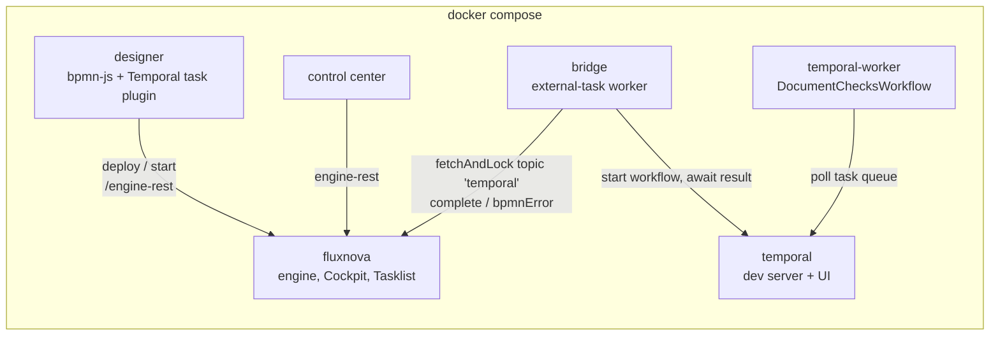

# Fluxnova × Temporal lab

A one-command lab showing how **Fluxnova** (BPMN process orchestration, FINOS)
and **Temporal** (durable execution) fit together: the business process stays in
Fluxnova, and one of its tasks runs as a Temporal workflow.

```bash
docker compose up --build
```

The first build takes a few minutes (Maven, npm and pip downloads). Then open:

| What | URL | Login |
| --- | --- | --- |
| Fluxnova Designer with the **Temporal task** plugin | http://localhost:8090 | |
| Fluxnova Cockpit / Tasklist / Admin | http://localhost:8080/fluxnova/app/ | demo / demo |
| Fluxnova Control Center | http://localhost:4000 | none (open) |
| Temporal Web UI | http://localhost:8233 | |

Needs Docker with Compose v2 and about 3 GB of free memory. Ports used: 4000,
8080, 8090, 7233, 8233.

## What runs



| Service | Folder | Role |
| --- | --- | --- |
| `fluxnova` | `fluxnova/` | Fluxnova 3.0.0 Spring Boot engine: REST API, Cockpit, Tasklist, in-memory H2. Deploys the sample process and decision at startup. |
| `control-center` | image `finos/fluxnova-control-center:1.3.0` | Fluxnova Control Center (Angular UI + NestJS BFF). Reads the lab engine at `http://fluxnova:8080/engine-rest`. No login, same as the open REST API. |
| `temporal` | image `temporalio/temporal` | Temporal dev server (`temporal server start-dev`) with its Web UI. |
| `temporal-worker` | `temporal-worker/` | Python worker running `DocumentChecksWorkflow`. |
| `bridge` | `bridge/` | Python service that turns Fluxnova external tasks on topic `temporal` into Temporal workflow runs. |
| `designer` | `designer/`, `plugin/` | Web BPMN designer built on `camunda-bpmn-js`, the same modeling library as the Fluxnova Modeler, with the Temporal task plugin. Also serves the desktop plugin as a zip. |

## The sample: customer onboarding (KYC)

```
Onboarding request -> Analyst review -> [Document checks] -> Credit decision (DMN) -> approve / review / reject
                       (human, Tasklist)   Temporal task  \
                                                           -> on BPMN error: Compliance exception (human)
```

**Fluxnova keeps** what business owners and auditors must read: the start
form, the human review, the DMN credit decision, the routing, and the
exception path.

**Temporal runs** the code-heavy step behind *Document checks*:
`DocumentChecksWorkflow` fetches documents, calls a (simulated) AI extraction
service that fails twice before succeeding (automatic retries, visible in the
Temporal UI), waits on a durable 5 s timer, screens sanctions, and compensates
(a saga step) if anything fails.

### Walkthrough

1. Open the **Designer** (http://localhost:8090). The KYC sample is loaded.
   *Document checks* carries the purple Temporal badge; select it to see the
   **Temporal workflow** section in the properties panel.
2. Click **Start instance** and keep the default variables.
3. Open **Tasklist** (demo/demo), claim and complete *Analyst review*.
4. Watch the **Temporal UI**: workflow `CUST-xxxx:Task_DocumentChecks` shows two
   failed extraction attempts, the timer, then completion.
5. In **Cockpit**, the instance has moved past *Document checks*.
   `riskScore`, `creditDecision` and `temporalUiUrl` (a link back to the
   Temporal run) are process variables.

Try the other paths from the start dialog:

| Variables | Outcome |
| --- | --- |
| `"country": "FR"`, amount 250000 | risk 10 → **Account opened** |
| `"country": "TR"` | risk 40 → **Senior review** (human task) |
| `"country": "RU"` | risk 70 → **Application rejected** |
| `"customerName": "Ivan Sanctioned"` | workflow raises `SANCTIONS_HIT` → BPMN error → **Compliance exception** |

### Build your own

In the designer, click **New**, drag **Create Temporal task** from the palette
(or use the wrench menu on any task → *Temporal task*), fill in *Workflow type*
and *Task queue*, then **Deploy to Fluxnova**. The bridge serves every Temporal
task in every process; only a worker for that workflow type is needed.

## Automated checks

```bash
# End to end against the running stack: three scenarios
docker compose exec bridge python -m fluxnova_temporal_bridge.smoke

# Unit tests
docker compose run --rm bridge pytest -q                       # mapping logic
docker compose run --rm temporal-worker pytest -q              # workflow (time-skipping test server)
node --test plugin/test/*.test.js                              # designer plugin (no npm install needed)
```

## The Temporal task contract

A Temporal task is a BPMN service task with `camunda:type="external"` and
`camunda:topic="temporal"`. Its input parameters configure the call. The
plugin writes them for you.

| Input parameter | Required | Meaning |
| --- | --- | --- |
| `temporalWorkflowType` | yes | Workflow type to start |
| `temporalTaskQueue` | yes | Task queue the worker polls |
| `temporalWorkflowId` | no | Default `${execution.processBusinessKey}:${execution.currentActivityId}`; falls back to the process instance id when there is no business key |
| `temporalInputVariables` | no | Comma-separated variables sent as one JSON object; empty sends all |
| `temporalResultVariable` | no | Where a non-object result goes (object results are merged into the process) |
| `temporalErrorCode` | no | BPMN error code thrown when the workflow fails |

Bridge behaviour, tied to the validation checklist in the study:

| Concern | How the lab handles it |
| --- | --- |
| Correlation | Workflow id = business key + task id. The bridge writes `temporalWorkflowId`, `temporalRunId` and `temporalUiUrl` on the process instance, and Fluxnova ids into the workflow memo. |
| Exactly-once start | `USE_EXISTING` conflict policy plus `ALLOW_DUPLICATE_FAILED_ONLY` reuse policy: a retried task re-attaches to the running workflow, or reuses a completed result. |
| Long runs | The Fluxnova lock is extended every 10 s while the workflow runs. |
| Business errors | `ApplicationError("msg", "CODE", type="BpmnError")` in the workflow becomes BPMN error `CODE`. Any other workflow failure becomes the task's `temporalErrorCode`. |
| Technical errors | Temporal unreachable → Fluxnova failure with retries, then a Cockpit incident. |
| Cancellation | If the Fluxnova task disappears (instance cancelled or modified), the bridge cancels the workflow, which runs its compensation. |

## Fluxnova Modeler (desktop) plugin

The designer serves the desktop plugin at
http://localhost:8090/downloads/fluxnova-temporal-task-plugin.zip. To build it
without Docker: `node plugin/build.mjs` writes it to `plugin/dist/fluxnova-temporal-task/`.

Unzip it into the Modeler's `resources/plugins` folder (for example
`/Applications/Fluxnova Modeler.app/Contents/MacOS/resources/plugins` on macOS)
and restart the Modeler. It uses the same `window.plugins` /
`bpmn.modeler.additionalModules` contract as the plugins in
[finos/fluxnova-modeler-plugins](https://github.com/finos/fluxnova-modeler-plugins).

## Layout

```
docker-compose.yml
fluxnova/          Spring Boot engine + sample BPMN and DMN (src/main/resources/processes)
bridge/            Fluxnova -> Temporal bridge, smoke test, unit tests
temporal-worker/   DocumentChecksWorkflow + activities + tests
plugin/            Temporal task bpmn-js module, element template, desktop plugin build
designer/          Web designer (nginx), proxies /engine-rest to the engine
```

## Notes and limits

- State is in memory: `docker compose down` resets Fluxnova and Temporal.
- Authorization is off in the engine and the REST API has no authentication.
  This is a lab, not a production setup.
- The bridge and worker are Python for brevity. The same pattern works with the
  Java external-task client and the Temporal Java SDK.
- Pin `TEMPORAL_CLI_VERSION` (for example in a `.env` file) for reproducible runs.

Licensed under Apache 2.0.
